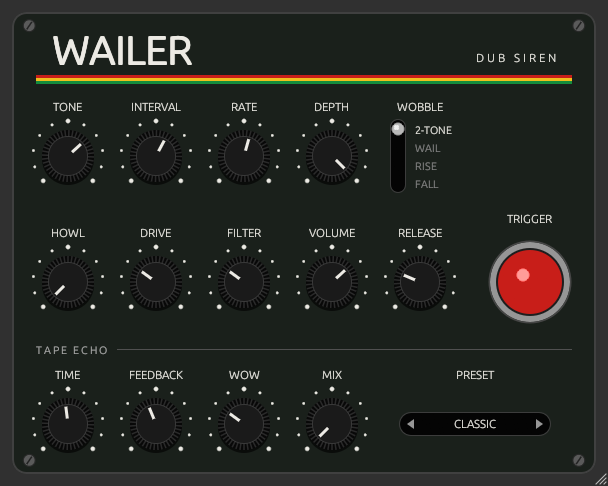

# Wailer

[](https://github.com/accraze/wailer/actions/workflows/ci.yml)

A sound-system dub siren plugin (CLAP / VST3) built with [nih-plug](https://github.com/robbert-vdh/nih-plug),
after the classic Jamaican dual-tone siren boxes.

<p align="center"></p>

A square oscillator wobbles between two tones, then goes through Howl feedback and the RAT
drive stage from [Rodent](https://github.com/accraze/rodent), into a built-in tape echo. It's an
instrument: hold a MIDI note or the Trigger button to sound it.

| Control      | Range                                                        |
|--------------|--------------------------------------------------------------|
| Trigger      | Momentary pad (also any MIDI note); each hit restarts the wobble |
| Tone         | 100–3000 Hz (tone A)                                         |
| Interval     | −24 to +24 semitones to tone B (fractional for detuned/beating) |
| Wobble Rate  | 0.1–30 Hz                                                    |
| Wobble Depth | 0–100% of the way from tone A to tone B                      |
| Wobble Shape | Two-tone (square), Wail (triangle), Rise, Fall               |
| Howl         | 0–100% feedback around the drive stage; squeals past ~70%    |
| Drive        | 0–100%, clean → screaming (RAT gain stage + diode clipper)   |
| Filter       | 0–100% (clockwise = darker)                                  |
| Volume       | −30 to +12 dB                                                |
| Release      | 0.01–5 s tail after you let go (time to fall 60 dB)          |
| Echo Time    | 50 ms–1.5 s; glides, so turning it bends the repeats' pitch  |
| Echo Feedback| 0–120%; past 100% the repeats run away (saturated, never blow up) |
| Echo Wow     | 0–100% tape wow (up to ±2 ms)                                |
| Echo Mix     | 0–100% repeats added on top of the dry siren (off by default) |
| Preset       | ‹ › steps through 7 level-matched factory presets; shows CUSTOM once you tweak |

Presets: Classic (dry two-tone, the default), Sound System, Police Wail, Laser, Rising Howl,
Dread Drop and Runaway (echo feedback past 100%).

Knobs: drag or scroll to turn, hold Shift for fine control, double-click to reset.
Drag the bottom-right corner to resize the window.

## Build

Needs a recent Rust from [rustup](https://rustup.rs) (distro packages are usually too old).
The GUI (egui) also needs X11/GL headers:

```sh
sudo apt install libx11-xcb-dev libxcb1-dev libxcb-dri2-0-dev libxcb-icccm4-dev libxcursor-dev libxkbcommon-dev libxcb-shape0-dev libxcb-xfixes0-dev libgl-dev
```

```sh
cargo xtask bundle wailer --release
cargo test --lib
```

Bundles land in `target/bundled/`.

## Install (Linux)

Grab `wailer-<version>-linux.zip` from [Releases](https://github.com/accraze/wailer/releases) and unzip it, or build it yourself. Then:

```sh
cp target/bundled/Wailer.clap ~/.clap/
cp -r target/bundled/Wailer.vst3 ~/.vst3/   # optional
```

Then rescan plug-ins in your DAW.

## Releasing

Changes are listed in [CHANGELOG.md](CHANGELOG.md). See [docs/RELEASING.md](docs/RELEASING.md) for the process. In short: bump the version, push an annotated `v*` tag, and CI publishes the release.

## License

Wailer is licensed under the [GNU General Public License v3.0 or later](LICENSE).
nih-plug itself is ISC licensed, but its VST3 bindings are GPLv3, so VST3 builds must be GPL anyway.
